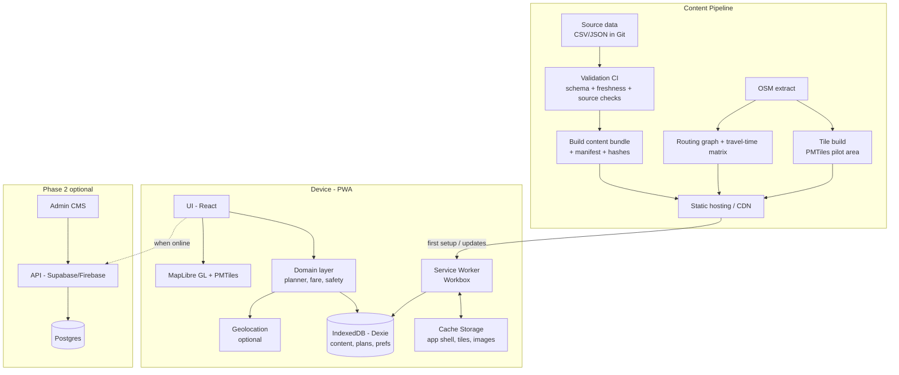
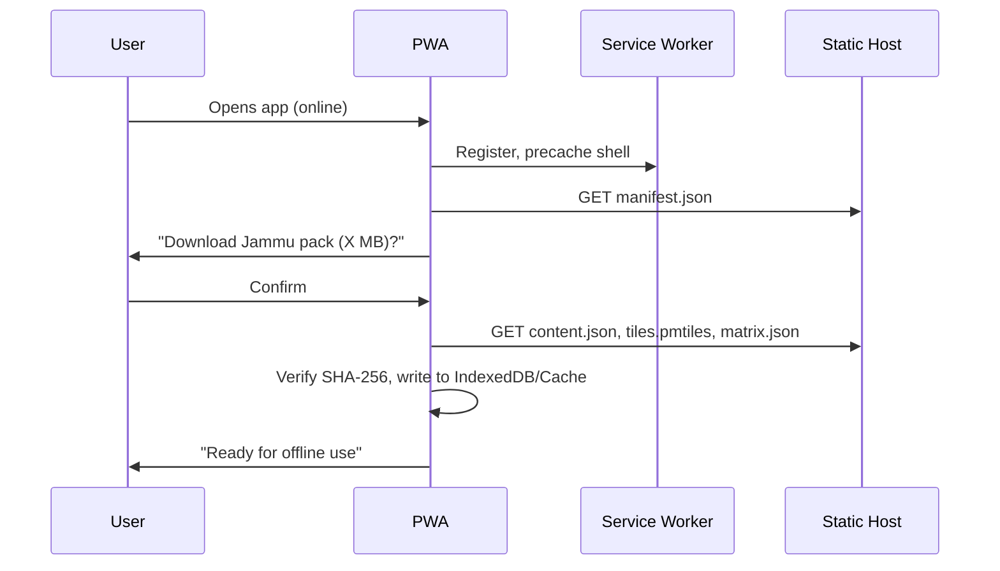

# Architecture

## 1. Architectural style
**Offline-first, client-heavy PWA** with a static, versioned **content bundle**. In Phase 1 there is no required server: the app is static files + data packs. Phase 2 adds an optional API for listings, feedback and an admin CMS.

## 2. High-level diagram



## 3. Tech stack

| Layer | Choice | Why |
|-------|--------|-----|
| UI | React 18 + TypeScript + Vite | Fast hackathon iteration, strong typing |
| Styling | Tailwind CSS + CSS variables (design tokens) | Tokens map to `DESIGN_SYSTEM.md` |
| PWA | `vite-plugin-pwa` (Workbox) | Precache shell, runtime-cache tiles |
| State | Zustand | Small, persistable |
| Local DB | Dexie (IndexedDB) | Structured offline content, queries |
| Map | MapLibre GL JS + PMTiles | Single-file offline vector tiles, no tile server |
| Tiles | OpenStreetMap data via Protomaps/Planetiler | Licensed (ODbL) — attribution required |
| Routing | Precomputed matrix + `ngraph.path` (or Valhalla offline as stretch) | Fully on-device |
| i18n | `react-i18next` | EN / HI / (Dogri stretch) |
| Validation | Zod (client) + JSON Schema (CI) | Same schemas both sides |
| Testing | Vitest, Playwright (offline mode), Lighthouse CI | See TESTING_METRICS |
| Hosting | Netlify / Cloudflare Pages / GitHub Pages | Static, HTTPS (required for service workers) |

**Alternative:** Flutter + `flutter_map` + MBTiles if the team is stronger in Dart. Everything else in this pack still applies.

## 4. Module breakdown

```
src/
├─ app/                 # routing, providers, layout shell
├─ features/
│  ├─ home/             # time input, quick actions
│  ├─ plan/             # itinerary builder + viewer
│  ├─ explore/          # attraction list/detail
│  ├─ map/              # map view, layers, route display
│  ├─ transport/        # modes, fare cards
│  ├─ safety/           # emergency contacts, guidance, help points
│  ├─ saved/            # saved places and plans
│  └─ settings/         # language, downloads, about, data freshness
├─ domain/
│  ├─ planner/          # time-box planner (see ITINERARY_ENGINE.md)
│  ├─ fares/            # fare lookup + staleness rules
│  ├─ trust/            # source-badge logic, verification status
│  └─ offline/          # capability matrix, bundle manager
├─ data/
│  ├─ db.ts             # Dexie schema
│  ├─ bundle/           # loader, hash verify, migrations
│  └─ schemas/          # Zod schemas
├─ services/
│  ├─ geolocation.ts
│  ├─ network.ts        # online/offline detection
│  └─ analytics.ts      # privacy-respecting, opt-in, queued offline
├─ ui/                  # shared components (see UI_COMPONENTS.md)
└─ i18n/
```

## 5. Key components

### 5.1 Bundle Manager
- Fetches `manifest.json` → compares `contentVersion` with local.
- Downloads data packs (content, tiles, matrix) with progress + resume.
- Verifies SHA-256 of each file before swapping into IndexedDB.
- Keeps previous version until the new one verifies (atomic swap).
- Exposes `lastUpdated`, `packSizes`, `status` to the UI.

### 5.2 Planner (on-device)
Input: start node, arrival time, departure time, preferences. Output: ordered stops with times, or an infeasibility reason. Details in `ITINERARY_ENGINE.md`.

### 5.3 Trust layer
Every data record carries `source`, `verification`, `updatedAt`. The UI derives a **badge** (Official / Verified / Third-party / Community) and a **freshness state** (Fresh / Aging / Stale) from these, never from free text.

### 5.4 Capability Matrix service
Maps each feature to `works_offline | needs_internet | degraded_offline`, and drives the persistent **ConnectivityBanner** and feature tooltips.

### 5.5 Map service
- Loads PMTiles via a custom protocol handler; range requests when online, local blob when downloaded.
- Layers: base, attractions, departure points, help points (hospitals, police, pharmacies), planned route, user location.
- Never draws a route labelled "safe." Labels are "walkable (est.)" / "road".

## 6. Data flow — first setup



## 7. Deployment

| Env | Purpose | Notes |
|-----|---------|-------|
| `dev` | local | `vite dev`, mock bundle |
| `staging` | QA + offline tests | Lighthouse CI, Playwright |
| `prod` | public | HTTPS, CSP headers, immutable hashed assets |

CI pipeline: lint → typecheck → unit tests → **data validation** → build bundle → Playwright offline tests → deploy.

## 8. Non-functional requirements

| Area | Target |
|------|--------|
| Cold start (after setup, offline) | < 3 s on mid-range Android |
| Initial pack size | < 60 MB (tiles ≤ 40 MB, content+images ≤ 20 MB) |
| Lighthouse PWA | Installable, offline-capable |
| Accessibility | WCAG 2.1 AA |
| Supported devices | Android Chrome 100+, iOS Safari 16.4+ (note storage eviction risk), low-end 2 GB RAM |
| Battery | No continuous GPS polling; sample on demand |

## 9. Known constraints
- iOS Safari may evict PWA storage after inactivity → show "re-download" prompt and an "Add to Home Screen" hint.
- Offline map tile coverage is limited to the pilot bounding box.
- No live data in Phase 1 → UI must never imply real-time info.
