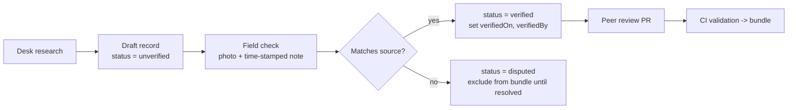

# Dataset Specification

All data lives in Git as JSON/CSV, validated in CI, and shipped as a versioned bundle. **Nothing is shown to users without `source` and `updatedAt`.**

## 1. Entities overview

```mermaid
erDiagram
  ATTRACTION ||--o{ OPENING_RULE : has
  ATTRACTION }o--|| AREA : in
  ATTRACTION ||--o{ MEDIA : has
  NODE ||--o{ TRAVEL_TIME : from
  NODE ||--o{ TRAVEL_TIME : to
  ATTRACTION }o--|| NODE : is
  DEPARTURE_POINT }o--|| NODE : is
  HELP_POINT }o--|| NODE : is
  FARE_REFERENCE }o--|| ROUTE_PAIR : for
  ROUTE_PAIR }o--|| NODE : origin
  ROUTE_PAIR }o--|| NODE : destination
  ITINERARY_TEMPLATE ||--o{ ITIN_STOP : contains
  ITIN_STOP }o--|| ATTRACTION : visits
  EMERGENCY_CONTACT }o--|| SOURCE : cites
  FARE_REFERENCE }o--|| SOURCE : cites
  ATTRACTION }o--|| SOURCE : cites
```

## 2. Common fields (every record)

| Field | Type | Required | Notes |
|-------|------|----------|-------|
| `id` | string (slug) | yes | stable, e.g. `attr_bahu_fort` |
| `source` | object | yes | `{ name, url, type, retrievedOn }` |
| `sourceType` | enum | yes | `official`, `verified_partner`, `third_party`, `community` |
| `verification` | object | yes | `{ status: verified\|unverified\|disputed, verifiedOn, verifiedBy, method }` |
| `updatedAt` | ISO date | yes | last content change |
| `reviewDueOn` | ISO date | yes | drives staleness chips |
| `i18n` | object | yes | `{ en: {...}, hi: {...} }` |

**Freshness rule:** `Fresh` ≤ 90 days since `verifiedOn`; `Aging` 91–180; `Stale` > 180 (or past `reviewDueOn`).

## 3. Entity schemas

### 3.1 Attraction
```json
{
  "id": "attr_bahu_fort",
  "type": "heritage",
  "name": { "en": "Bahu Fort", "hi": "बाहु किला" },
  "summary": { "en": "TODO(verify): 2-line description from official listing" },
  "nodeId": "node_bahu_fort",
  "areaId": "area_bahu_tawi",
  "tags": ["heritage", "fort", "temple", "views"],
  "visit": { "typicalMinutes": 60, "minMinutes": 30, "bestTime": "morning", "indoorOutdoor": "outdoor" },
  "priority": 5,
  "accessibility": {
    "stepFree": "TODO(verify)", "restrooms": "TODO(verify)", "seating": "TODO(verify)", "walkingLoad": "medium"
  },
  "opening": [{ "days": ["mon","tue","wed","thu","fri","sat","sun"], "open": "TODO(verify)", "close": "TODO(verify)" }],
  "entryFee": { "amountInr": null, "note": "TODO(verify)" },
  "cautions": ["Dress modestly at temple areas (TODO verify rules)"],
  "media": ["img_bahu_fort_1"],
  "source": { "name": "District Jammu - Tourist Places", "url": "https://jammu.nic.in/tourism/tourist-places/", "type": "official", "retrievedOn": "2026-10-17" },
  "verification": { "status": "unverified", "verifiedOn": null, "verifiedBy": null, "method": "desk research" },
  "updatedAt": "2026-10-17",
  "reviewDueOn": "2027-01-15"
}
```

**Seed list (from problem statement):** Bagh-e-Bahu, Bahu Fort, Raghunath Temple, Mubarak Mandi Palace, Amar Mahal, Tawi Riverfront. Add 4–6 more after checking the official tourism portal (e.g., museums, other temples, markets). **Coordinates, hours and fees must be surveyed or sourced; don't invent them.**

### 3.2 Node (graph point)
```json
{ "id": "node_jammu_tawi_station", "kind": "departure|attraction|help|junction", "lat": 0.0, "lng": 0.0, "name": {"en":"Jammu Tawi Railway Station"} }
```

### 3.3 Departure point
Pilot set: Jammu Tawi railway station, Jammu railway station (if applicable, TODO verify), main bus stand(s), Jammu airport. Fields: `nodeId`, `mode` (rail/bus/air), `checkInBufferMin` (recommended minimum arrival before departure: rail 30, bus 20, air 120 — **tunable defaults, TODO verify with user testing**), `pickupPoints[]`.

### 3.4 Travel-time matrix
Precomputed pairwise durations between all nodes, per mode.
```json
{
  "from": "node_jammu_tawi_station", "to": "node_bahu_fort",
  "mode": "taxi_auto", "minutes": { "typical": 25, "peak": 40 },
  "distanceKm": 0.0, "basis": "OSM graph, free-flow x 1.3 peak factor", "computedOn": "2026-10-17"
}
```
Modes: `walk`, `auto_taxi` (road). `bus` only if schedule data exists. Peak multiplier is a documented assumption, validated by field timing.

### 3.5 Fare reference
```json
{
  "id": "fare_station_to_bahu_taxi",
  "routePairId": "rp_station_bahu",
  "vehicle": "taxi",
  "amount": { "min": null, "max": null, "currency": "INR" },
  "basis": "official_notified | meter_estimate | observed_survey",
  "conditions": "e.g. daytime, one-way, up to 4 passengers TODO(verify)",
  "source": { "name": "TODO: RTO/Transport dept notification or prepaid booth rate card", "url": "", "type": "official" },
  "verification": { "status": "unverified" },
  "updatedAt": "2026-10-17",
  "reviewDueOn": "2027-01-15",
  "disclaimer": "Reference only. Actual fare may differ."
}
```
**Hard rules:**
1. If `source` is missing → record is **not bundled**.
2. `basis = observed_survey` must show "Based on field survey on <date>" and never use the word "official".
3. Stale fares show a warning chip and are excluded from itinerary cost totals unless user opts in.

### 3.6 Emergency contact
```json
{
  "id": "em_unified_112",
  "category": "all_emergencies",
  "name": { "en": "Emergency Response Support System" },
  "number": "112",
  "availableOffline": true,
  "notes": "National unified emergency number",
  "source": { "name": "TODO: official page", "type": "official" },
  "verification": { "status": "unverified" }
}
```
Seed numbers to **verify before release**: 112 (unified), 100 (police), 101 (fire), 102/108 (ambulance), 1363 (tourist helpline), 1091 (women helpline). Add: nearest hospitals, district control room, Vaishno Devi shrine board helpline, railway helpline — **only after verifying each from official sources.**

### 3.7 Help point
`kind`: `hospital | police | pharmacy | railway_help | tourist_help`. Fields: `nodeId`, `name`, `phone` (nullable), `hours24x7` (bool, verified), `address`.

### 3.8 Itinerary template
Hand-curated "anchor" plans the generator can start from or fall back on.
```json
{
  "id": "tpl_4h_heritage_core",
  "durationBucket": "4h",
  "startArea": "area_station",
  "stops": [
    { "attractionId": "attr_raghunath_temple", "order": 1 },
    { "attractionId": "attr_bahu_fort", "order": 2 }
  ],
  "mobility": ["walk_ok", "minimal_walk"],
  "notes": "Validated by field test on TODO date"
}
```

### 3.9 Safety guidance card
`id`, `scenario` (road_incident, medical, lost_phone, heat, theft, stranded_late), `steps[]` (short imperative lines), `relatedContacts[]`, `source`, `verification`.

### 3.10 Media
`id`, `path`, `alt` (i18n, required), `credit`, `license` (**must be licence-cleared**), `bytes`.

### 3.11 Source registry
Central list of every source with `id, name, url, type, lastChecked, contactPerson`. Records reference `sourceId` to avoid duplication.

### 3.12 Business listing (Phase 2)
`id, name, category (hotel|restaurant|guide|artisan|transport), nodeId, phone, hours, languages, priceBand, verification {status, method, verifiedOn}, consent {signedOn, contact}, sponsored (bool — must be shown as "Promoted")`.

## 4. Data sources (starting points from the statement)

| Data | Candidate source | Type |
|------|------------------|------|
| Attractions | District Jammu tourist places page; Directorate of Tourism Jammu portal | official |
| Pilgrim volume context | Ministry of Tourism parliamentary response; Shrine Board statistics | official |
| Riverfront events | Jammu Municipal Corporation announcements | official |
| Maps | OpenStreetMap (ODbL) | third-party open |
| Fares | Transport dept / RTO notifications, prepaid booth rate cards, structured field survey | official / survey |
| Emergency | Official government portals, district control room | official |
| Hours/fees | Site visit + official listing | verified on-site |

## 5. Collection & verification workflow



## 6. CI validation rules
- JSON Schema + Zod pass
- Required fields present; i18n has `en` and `hi` (or marked `TODO_TRANSLATE`)
- Every fare/emergency/attraction has `source` + `updatedAt`
- Phone numbers match `^\+?[0-9\- ]{3,15}$`
- Coordinates inside pilot bounding box
- No record with `verification.status = disputed` ships
- Images have `alt` and `license`
- Travel-time matrix is complete for all attraction ↔ departure pairs
- Bundle size within budget

## 7. Bundle layout
```
bundle/
├─ manifest.json          # version, files, sha256, sizes, minAppVersion
├─ content.json           # attractions, nodes, fares, contacts, guidance, templates
├─ matrix.json            # travel times
├─ i18n/en.json, hi.json
├─ media/*.webp
└─ tiles/jammu-pilot.pmtiles
```
