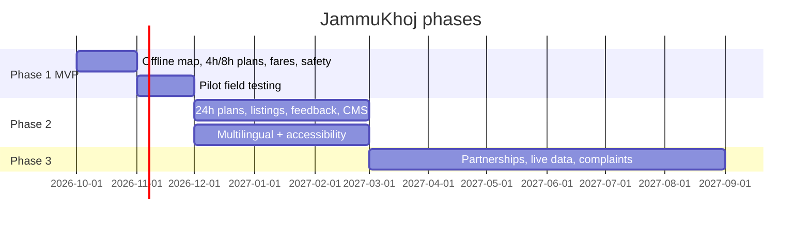

# Roadmap, Timeline & Risks

## 1. Hackathon plan (example: 48 hours)

| Block | Work | Owner |
|-------|------|-------|
| H0–4 | Finalise scope, pick 8–10 attractions, set up repo, design tokens | All |
| H4–12 | Data collection (sources, coordinates, hours), build OSM extract + PMTiles | Data |
| H4–16 | PWA shell, routing, i18n, offline service worker, Dexie schema | Frontend |
| H12–24 | Planner + matrix, itinerary UI, Return-by bar | Frontend + Logic |
| H16–28 | Map screen, routes, help-point layer | Frontend |
| H24–34 | Transport/fare cards, Safety screen, trust badges | Frontend + Data |
| H34–40 | Offline testing, field test, bug fixes | All |
| H40–46 | Polish, accessibility pass, demo script, README | All |
| H46–48 | Demo rehearsal, backup video, deploy | All |

**Suggested team split (4 people):** Product/Data · Frontend A (planner/UI) · Frontend B (map/offline) · Design/QA.

## 2. Demo script (3 minutes)
1. Problem (20 s): pilgrim, 8 h gap, no network.
2. Install & download pack (20 s).
3. **Airplane mode on.** Plan my stop → 8 h plan with Return-by clock (60 s).
4. Map + route to a stop + back to the station (30 s).
5. Fare card: reference, source, date, how to verify (20 s).
6. Safety screen (20 s).
7. Roadmap + honest limitations (10 s).

Always have a recorded backup video.

## 3. Phases

## 4. Phase deliverables

| Phase | Deliverable | Exit criteria |
|-------|-------------|---------------|
| 1 | Working PWA for pilot area | Offline test matrix passes; data QA complete |
| 2 | CMS, listings, feedback, Dogri/Punjabi | 20+ verified listings; moderation SLA |
| 3 | Authorised integrations | Signed MoU/data agreement; live feeds in pilot |

## 5. Risk register

| Risk | Likelihood | Impact | Mitigation |
|------|:---------:|:------:|-----------|
| No official fare data available | High | High | Use observed survey labelled as such, or ship without fares for those routes |
| Opening hours unverifiable | Med | Med | Exclude unverified stops by default; field visit |
| Map pack too large | Med | Med | Smaller bounding box, lower zoom levels |
| iOS storage eviction | Med | Med | Persist request, re-download prompt, install guidance |
| Inaccurate travel times | Med | High | Peak factor + field validation + buffers |
| Over-claiming safety/verification | Med | High | Claim policy in SECURITY.md, copy review |
| Licensing issues (images/maps) | Med | Med | Self-shot photos, ODbL attribution |
| Scope creep (booking, AR, SOS) | High | High | Hard cut line in PRODUCT_SCOPE.md |
| Wrong emergency numbers | Low | Critical | Two-person verification, official sources |
| Team time | High | Med | Cut 24h plan and Hindi extras first |

## 6. Cut-list order (if time runs out)
1. 24-hour plan
2. Dogri language
3. Re-plan "I'm running late"
4. Dark mode
5. Share plan as image
6. Help-point layer (keep emergency numbers)

**Never cut:** offline map, return buffer, source/date labels, emergency screen.

## 7. Future ideas (not in scope)
Live transport availability, official complaint submission, SOS with live location, AR heritage overlays, accessibility-optimised routing, expansion to Katra and Srinagar.
