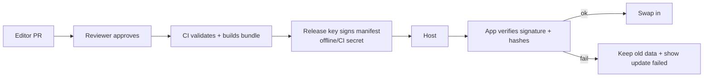

# Security, Privacy & Trust

## 1. Security goals
1. **Integrity** of safety-critical data (emergency numbers, fares, map data).
2. **Privacy** of visitor location and behaviour.
3. **Availability** offline — the app must not fail closed when the network is down.
4. **Honest claims** — avoid misleading users about safety, verification or official status.

## 2. Assets & threats (STRIDE-lite)

| Asset | Threat | Impact | Mitigation |
|-------|--------|--------|------------|
| Emergency numbers | Tampered bundle / typo / outdated | Critical | Signed manifest + hashes, two-person approval, verification dates, bundled fallback in app shell |
| Fare references | Fake or manipulated "fare" data to steer users to a driver | High | Source + date mandatory, no paid placement in fares, audit log |
| Content bundle in transit | MITM, CDN compromise | High | HTTPS + HSTS, SHA-256 per file, manifest signature (Ed25519), pinned public key in app |
| Service worker | Malicious script injection / XSS | High | Strict CSP, no inline scripts, Trusted Types where possible, dependency lockfile + audit |
| User location | Over-collection / leakage | High | On-device only; no transmission in Phase 1 |
| Business listings (Ph.2) | Fake businesses, impersonation, scams via the app itself | High | Verification workflow, OTP, "verified" only by staff, report button |
| Feedback (Ph.2) | Spam, abuse, PII | Medium | Rate limits, captcha/proof-of-work, moderation, PII stripping |
| Admin / CMS | Account takeover | High | MFA, least privilege, session timeout, audit logs |
| Phishing clones of the app | Fake "JammuKhoj" sites | Medium | Single canonical domain, display domain in About, signed bundles |
| Map data | Outdated/incorrect restricted area info | Medium | Disclaimer, dated map pack, no "safe route" claims |

## 3. Data classification

| Class | Examples | Handling |
|-------|----------|----------|
| Public | Attractions, fares, contacts | Open, signed |
| Local-private | Saved plans, GPS fixes, language pref | Stays on device; not synced |
| Account (Ph.2) | Business owner phone/email | Encrypted at rest, minimal retention |
| Operational | Audit logs, release keys | Restricted, rotated |

## 4. Privacy by design
- **No login, no PII** in Phase 1.
- No third-party trackers, no ad SDKs; self-hosted fonts to avoid IP leakage to font CDNs.
- Geolocation: request only on user action, explain why; handle denial gracefully.
- Analytics (optional): event counts only, no IDs, opt-in, localized consent text. Queue offline and send in batches.
- "Copy my location" produces text locally; nothing is sent.
- Provide in-app **Privacy** page in plain language (EN/HI) and a "Clear local data" button.
- Align with India's Digital Personal Data Protection Act, 2023 once personal data is collected (Phase 2): notice, purpose limitation, consent, deletion. **Get legal review before Phase 2.**

## 5. Web security controls

**Headers (static host config)**
```
Content-Security-Policy: default-src 'self'; script-src 'self'; style-src 'self'; img-src 'self' data: blob:; font-src 'self'; connect-src 'self' <api-host>; worker-src 'self'; frame-ancestors 'none'; base-uri 'none'
Strict-Transport-Security: max-age=63072000; includeSubDomains; preload
X-Content-Type-Options: nosniff
Referrer-Policy: no-referrer
Permissions-Policy: geolocation=(self), camera=(), microphone=()
```
- Dependabot/npm audit in CI; pin versions; Subresource Integrity for any external asset (avoid external if possible).
- Sanitise any rendered rich text (use a safe markdown subset; no raw HTML).
- External links: `rel="noopener noreferrer"`, show domain before leaving the app.
- `tel:` links only built from validated numbers.

## 6. Content integrity chain



## 7. Safety-claim policy (trust & legal)

| Don't say | Say instead |
|-----------|-------------|
| "Safe route" | "Suggested route (walkable estimate)" |
| "Verified driver/operator" | Only when a documented verification exists: "Verified on 12 Oct 2026 by field team" |
| "Official fare" | "Fare reference — source: ..., updated: ..." |
| "Emergency service" | "Emergency contacts — call 112" |
| "Real-time" | Not used in Phase 1 |
| "Government approved" | Never, unless a formal agreement exists |

Standing disclaimer on Safety and Transport screens: *JammuKhoj provides reference information and does not replace official emergency services.*

## 8. Abuse & scam resistance (for the app itself)
- No paid placement in Transport or Safety sections.
- Promoted business listings visually separate and labelled.
- Report button on every listing (Phase 2) with triage SLA.
- Takedown process documented.

## 9. Licensing & compliance
- **OpenStreetMap:** ODbL attribution "© OpenStreetMap contributors" visible on map.
- Map tile/vector provider terms checked (Protomaps, etc.).
- Images: only licence-cleared or self-shot; store credit/licence in data.
- Government content: check re-use terms for text/data before copying.
- Accessibility statement and contact for corrections.

## 10. Incident response (minimal)
1. Wrong emergency/fare data reported → hotfix path: editor PR → single-reviewer emergency approval → bundle patch within 24 h → in-app "Important update" banner.
2. Key compromise → rotate signing key, ship app update with new public key, revoke old bundles.
3. Publish a corrections log in the app (About → Corrections).

## 11. Security checklist (pre-demo)
- [ ] HTTPS only, headers applied
- [ ] Manifest signature verified in app
- [ ] No secrets in repo
- [ ] Dependencies audited
- [ ] Location permission flow tested (grant/deny/revoke)
- [ ] Emergency numbers verified by second person
- [ ] Privacy page live
- [ ] Clear-local-data works
