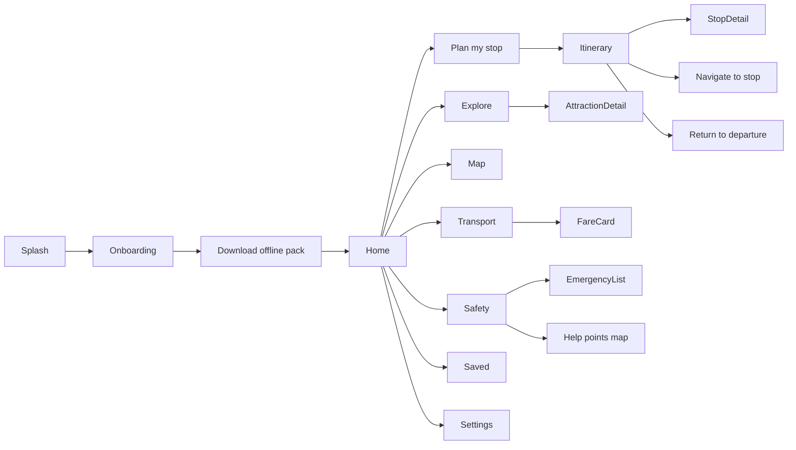
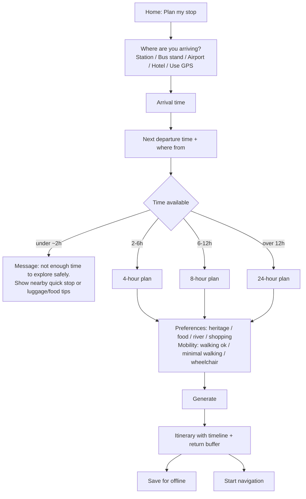
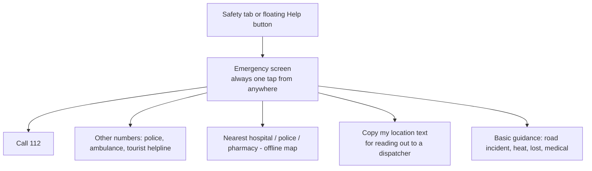

# User Flows

## 1. Site map

Bottom navigation (5 tabs): **Home · Plan · Map · Transport · Safety**. Saved and Settings live under a top-bar menu.

## 2. Flow A — First launch & offline setup

1. Splash → language choice (English / हिन्दी).
2. Onboarding (3 cards, skippable): *Plan a short stay · Works without internet · Safety info on hand*.
3. "Download Jammu pack" screen: size, what's included, Wi-Fi recommended, **Download** / **Later**.
4. Progress with pause/resume. Success: "Ready offline. Last updated 12 Oct 2026."
5. Error states: low storage, network drop (resume), hash mismatch (retry).

**Gate:** if user skips, Home shows a persistent "Offline pack not downloaded" banner.

## 3. Flow B — Plan my stop (core flow)

**Itinerary screen shows:** departure countdown ("Be back at Jammu Tawi by 13:15"), timeline of stops with travel and visit durations, buffer block, fare reference for each leg, "Why this plan?" explanation, Save, Share (image/text), Swap a stop.

**Failure messages (plain language):**
- "You have 1 h 40 m. That's not enough to see the city and return safely. Here are options near the station."
- "Opening hours for Amar Mahal Museum haven't been verified. We left it out. [Include anyway]"

## 4. Flow C — During the trip (offline)

1. User opens saved plan → banner: "Offline — maps, plan and safety info available."
2. Taps **Next stop** → map with route line, distance, est. time. Location dot if GPS permits.
3. Running late? "I'm running late" button → recalculates; drops lowest-priority remaining stop; warns if return buffer would be breached.
4. **Return now** always visible → route to departure point + required time.

## 5. Flow D — Check a fare (transport)

1. Transport tab → list of modes (auto, taxi, e-rickshaw, bus, etc. — only those with data).
2. Select route (From → To) → **Fare reference card**:
   - Amount / range, vehicle type, **Source**, **Updated on**, status chip (Fresh/Aging/Stale)
   - "This is a reference, not a guaranteed price."
   - "How to verify": ask for meter/rate card, check registration plate, prepaid booth if available.
   - "Report an issue": shows official complaint instructions (phone/URL) — Phase 1 info only.

## 6. Flow E — Emergency

Rules: tel: links work offline on devices with cellular voice; disclaimer visible; "Copy location" produces plain text (lat/long + nearest landmark from local data) — it does not transmit anything.

## 7. Flow F — Explore

Explore → filter chips (Heritage, Religious, Riverfront, Markets, Food) + "Fits in" duration filter → card list → Attraction detail: photo, 2-line summary, typical visit time, opening info (with verified date), best time, accessibility notes, nearest transport, "Add to plan", "Save", "Navigate".

## 8. Flow G — Update content

Settings → Offline pack → shows version, last updated, size → **Check for updates** (online only) → diff summary ("3 fares updated, 1 attraction added") → Update → atomic swap.

## 9. Edge cases

| Case | Behaviour |
|------|-----------|
| GPS denied | Manual start-point picker; no blocking |
| No internet and no pack | Show static emergency numbers bundled in the app shell + instructions to download later |
| Pack partially downloaded | Resume; map features disabled until tiles complete |
| Clock/timezone wrong | Warn if device time differs strongly from last-sync time |
| Train delayed | "Change departure time" quick action on plan screen |
| Rain/heat | Static advisory card (not live weather) in Phase 1 |
| Stale data (> 180 days) | Show "Stale" chip, suggest verifying before relying |
